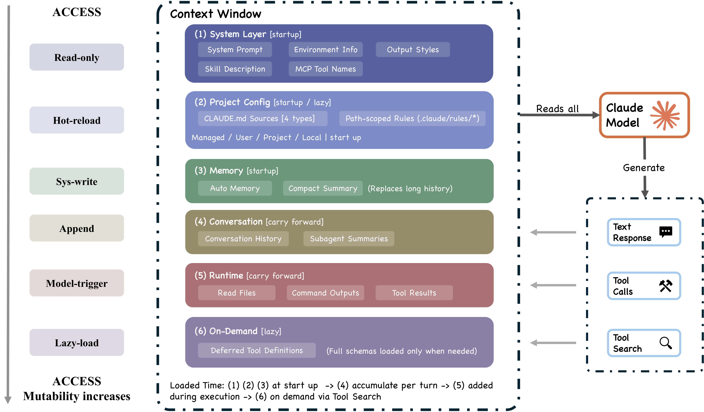

[返回主 README](../README_zh.md)

# 架构总览

> 核心智能体循环是一个简单的 while 循环。大部分代码都存在于围绕它的各类系统中。

本章描述论文所分析的 **Claude Code v2.1.88** 源码快照。后续进展与更广泛的设计选择，见[构建指南](./build-your-own-agent_zh.md)和[来源笔记](./agent-design-space-source-notes_zh.md)。

## 每个编码智能体必须回答的四个设计问题

| 设计问题 | Claude Code 的答案 | 替代方案 |
|:----------------|:---------------------|:-------------|
| **推理放在哪里？** | 模型推理；harness 强制执行。约 1.6% AI 决策逻辑，98.4% 基础设施。 | LangGraph：显式状态图。Devin：多步规划器。 |
| **有多少个执行引擎？** | 一个 `queryLoop` 供所有入口（CLI、SDK、IDE）共用。 | 按入口分别实现专用引擎。 |
| **默认安全姿态是什么？** | 拒绝优先：拒绝 > 询问 > 允许。最严格的规则优先。 | 容器隔离（SWE-Agent）、git 回滚（Aider）。 |
| **最根本的资源约束是什么？** | 有限的上下文窗口。模型调用前的五个处理阶段根据配置与上下文压力生效。 | 计算预算、显式草稿本。 |

## 高层系统结构（7 个组件）

  

1. **用户** —— 提交提示、批准权限、审查输出
2. **入口** —— 交互式 CLI、headless CLI（`claude -p`）、Agent SDK、IDE/桌面/浏览器
3. **智能体循环** —— `query.ts` 中的 `queryLoop` 异步生成器：模型调用 → 工具分派 → 结果收集 → 重复
4. **权限系统** —— 拒绝优先规则 + auto 模式 ML 分类器 + 钩子拦截
5. **工具** —— 最多 54 个内置工具 + MCP 提供的工具，通过 `assembleToolPool` 组装
6. **状态与持久化** —— 仅追加的 JSONL 转录稿、提示历史、子智能体侧链
7. **执行环境** —— Shell（带沙箱）、文件系统、Web 获取、MCP 连接

所有入口最终都汇聚到同一个 `queryLoop`——交互式 CLI、headless 模式、SDK 和 IDE 共用同一套代码路径。`QueryEngine` 是一层会话包装，而不是引擎本身。

## 5 层子系统分解（21 个子系统）

| 层 | 职责 | 关键组件 |
|:------|:---------------|:---------------|
| **表层（Surface）** | 入口与渲染 | CLI、headless、SDK、IDE（React + Ink 终端 UI） |
| **核心** | 上下文组装与智能体循环 | `queryLoop`、5 阶段压缩管道、子智能体生成 |
| **安全/行动** | 权限与工具 | 7 个权限模式、auto 模式分类器、27 个钩子事件、工具池、shell 沙箱 |
| **状态** | 运行时状态与持久化 | JSONL 转录稿、CLAUDE.md 层级、自动记忆、侧链文件 |
| **后端** | 执行环境 | Shell 执行、MCP 连接（7 种传输类型）、42 个工具子目录 |

## 七个安全层

论文把保护机制归为七个层次。具体执行哪些检查，取决于工具、模式和配置；不同层仍可能共享故障原因。

1. **工具预过滤** —— 把被全局拒绝的工具从模型可见的工具清单中彻底剔除
2. **拒绝优先规则评估** —— 拒绝始终覆盖允许，即使允许更具体
3. **权限模式约束** —— 当前活跃模式决定基线处理
4. **Auto 模式 ML 分类器** —— 独立评估安全性的单独 LLM 调用
5. **Shell 沙箱** —— 对 shell 命令实施文件系统 + 网络隔离
6. **会话级权限状态** —— [会话内的应用白名单](https://github.com/chauncygu/collection-claude-code-source-code/blob/53faa8b2162fc7a4dce2e79b55b7101bb8f9e2bf/claude-code-source-code/src/state/AppStateStore.ts#L260)不随 resume 恢复；[会话级 bypass 标志](https://github.com/chauncygu/collection-claude-code-source-code/blob/53faa8b2162fc7a4dce2e79b55b7101bb8f9e2bf/claude-code-source-code/src/bootstrap/state.ts#L132)不持久化。
7. **基于钩子的拦截** —— PreToolUse 钩子可以修改或阻止操作

在 [Bash 的旧解析路径](https://github.com/chauncygu/collection-claude-code-source-code/blob/53faa8b2162fc7a4dce2e79b55b7101bb8f9e2bf/claude-code-source-code/src/tools/BashTool/bashPermissions.ts#L2162)中，命令拆分出的子命令超过 50 个时，权限检查会返回 `ask` 决策，避免逐个分析长时间占用事件循环。

## 轮次执行：9 步管道

  

每个轮次遵循**9 步管道**：

1. 设置解析 → 2. 状态初始化 → 3. 上下文组装 → 4. 适用的上下文处理阶段 → 5. 模型调用 → 6. 工具分派 → 7. 权限门控 → 8. 工具执行 → 9. 停止条件检查

### 五个预模型上下文整形阶段

[查询循环](https://github.com/chauncygu/collection-claude-code-source-code/blob/53faa8b2162fc7a4dce2e79b55b7101bb8f9e2bf/claude-code-source-code/src/query.ts#L369)在调用模型前按顺序检查这些阶段，各阶段只有满足自身条件时才改变上下文：

| 阶段 | 策略 | 触发条件 |
|:------|:---------|:--------|
| 预算削减 | 每条消息的工具结果大小上限 | 已启用预算状态，且内容超限 |
| 裁剪 | 裁剪较旧的历史 | 受特性开关控制（`HISTORY_SNIP`） |
| 微压缩 | 清理较旧的工具结果 | 符合条件的主线程请求达到时间阈值，或使用可选的缓存编辑路径 |
| 上下文折叠 | 读取时虚拟投影（非破坏性） | 受特性开关控制（`CONTEXT_COLLAPSE`） |
| 自动压缩 | 模型生成摘要 | 已启用且超过阈值，同时受运行模式与失败保护条件约束 |

### 恢复机制

- 最大输出 token 升级（每轮最多重试 3 次）
- 反应式压缩（每轮最多触发一次）
- 提示过长：用上下文折叠处理溢出 → 反应式压缩 → 终止
- 流式后备和后备模型切换

## 权限系统深度剖析

  

### 7 个权限模式

| 模式 | 行为 | 信任级别 |
|:-----|:---------|:------------|
| `plan` | 用户在执行前批准所有计划 | 最低 |
| `default` | 标准交互批准 | 低 |
| `acceptEdits` | 文件编辑 + 文件系统 shell 自动批准 | 中 |
| `auto` | ML 分类器评估工具安全性 | 高 |
| `dontAsk` | 无提示，仍强制执行拒绝规则 | 较高 |
| `bypassPermissions` | 跳过大多数提示，仍保留安全相关的关键检查 | 最高 |
| `bubble` | 内部：子智能体向父级上报 | 特殊 |

### 授权管道

4 阶段流程：**预过滤**（从模型视野中剥离被拒绝的工具）→ **PreToolUse 钩子**（可以返回 `permissionDecision`）→ **规则评估**（拒绝优先）→ **权限处理程序**（4 个分支：协调器、swarm worker、推测式分类器、交互式）

### Auto 模式分类器

`yoloClassifier.ts`：加载基础系统提示 + 权限模板（内部/外部各一套）。两阶段评估：快速过滤 + 思维链。预计算的分类结果与超时时限竞争。

## 可扩展性：MCP、插件、Skills 和 Hooks

  

### 四个扩展机制

上下文成本取决于模型实际收到哪些文本，以及它们何时加载。Hook 可以注入上下文；调用模型的 hook 还会产生单独的推理成本。

| 机制 | 可能进入模型上下文的内容 | 关键能力 |
|:----------|:-------------|:---------------|
| **Hooks** | Hook 按需返回的上下文 | 27 个事件，4 种执行类型（shell、LLM、webhook、subagent 验证器） |
| **Skills** | 描述与相关 skill 的指令 | 具有 15+ YAML frontmatter 字段的 SKILL.md，通过 SkillTool 元工具注入 |
| **Plugins** | 所启用组件引入的上下文 | 10 种组件类型（命令、智能体、skills、hooks、MCP、LSP、样式...） |
| **MCP 服务器** | 根据发现与加载方式提供的工具 schema 和结果 | 通过 7 种传输类型的外部工具（stdio、SSE、HTTP、WebSocket、SDK、IDE） |

### 工具池组装（5 步管道）

基础枚举（最多 54 个工具）→ 模式过滤 → 拒绝规则预过滤 → MCP 集成 → 去重

### 三个注入点

- **assemble()** —— 模型看到的内容：CLAUDE.md、skill 描述、MCP 资源、钩子注入的上下文
- **model()** —— 模型能触及的内容：内置工具、MCP 工具、SkillTool、AgentTool
- **execute()** —— 操作是否/如何运行：权限规则、PreToolUse/PostToolUse 钩子、Stop 钩子

## 上下文构建与记忆

  

### 9 个有序上下文来源

系统提示 → 环境信息 → CLAUDE.md 层级 → 按路径限定的规则 → 自动记忆 → 工具元数据 → 对话历史 → 工具结果 → 压缩摘要

### CLAUDE.md 层级（4 级）

| 级别 | 路径 | 范围 |
|:------|:-----|:------|
| 托管 | `/etc/claude-code/CLAUDE.md` | 系统范围（企业） |
| 用户 | `~/.claude/CLAUDE.md` | 用户级 |
| 项目 | `CLAUDE.md`、`.claude/CLAUDE.md`、`.claude/rules/*.md` | 项目级 |
| 本地 | `CLAUDE.local.md` | 个人（被 gitignore 忽略） |

**指令与执行约束需要分开。** CLAUDE.md [通过用户上下文注入](https://github.com/chauncygu/collection-claude-code-source-code/blob/53faa8b2162fc7a4dce2e79b55b7101bb8f9e2bf/claude-code-source-code/src/utils/api.ts#L449)。用户上下文与系统提示都会引导模型行为；指令优先级并不保证模型一定遵从。权限检查与沙箱限制则在动作执行时实施约束。

### 基于文件的记忆

- 不使用嵌入向量，也没有向量数据库——由 LLM 扫描记忆文件的文件头
- 按需挑出最多 5 个相关文件
- 用户可以直接查看、编辑，并纳入版本控制

## 子智能体委托

  

### 6 个内置类型 + 自定义智能体

内置：Explore、Plan、General-purpose、Claude Code Guide、Verification、Statusline-setup。

自定义：`.claude/agents/*.md`，YAML frontmatter 支持 tools、model、permissions、hooks、skills 等。

### 关键设计：SkillTool vs AgentTool

- **SkillTool**：将指令注入当前对话。
- **AgentTool**：在独立对话中执行子任务，模型调用与协调成本取决于具体任务。

分开对话可以限制进入父级上下文的中间过程。文件系统访问与权限则取决于执行后端和配置。

### 三种隔离模式

| 模式 | 机制 | 默认 |
|:-----|:----------|:--------|
| Worktree | Git worktree（文件系统隔离） | 否 |
| Remote | 远程执行（内部专用） | 否 |
| In-process | 共享文件系统，隔离对话 | 是 |

### 侧链转录稿

子智能体的转录稿使用独立的 `.jsonl` 文件。父级通过 AgentTool 接收结果内容；转录稿存储与结果回传承担不同职责。多实例之间通过 POSIX `flock()` 协调——零外部依赖。

## 会话持久化

  

### 三个持久化通道

| 通道 | 格式 | 目的 |
|:--------|:-------|:------|
| 会话转录稿 | 仅追加的 JSONL | 完整对话，压缩边界采用链式修补 |
| 全局提示历史 | `history.jsonl` | 跨会话提示召回（反向读取用于上箭头） |
| 子智能体侧链 | 每个子智能体独立的 JSONL | 隔离的子智能体历史 |

### 恢复会话时的临时授权

在 v2.1.88 快照中，会话内的应用白名单不随 resume 恢复，会话级 bypass 标志不持久化。两者都不写入转录稿，因此用 `--resume` 启动的新进程不带有它们；在运行中的会话内 resume 或 fork 会话时，已经给出的授权仍然有效。这些规则针对具体的临时会话状态，不能概括为持久策略或运行模式的统一恢复规则。

### 设计权衡

仅追加的 JSONL 设计，体现了一次偏向**可审计性与简单性、而非查询能力**的取舍。每条事件既可被人工阅读，也能纳入版本控制，无需专用工具即可重建。
